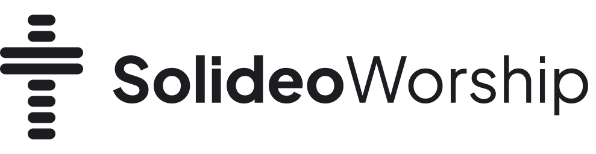

<h1>
  <picture>
    <source media="(prefers-color-scheme: dark)" srcset="assets/logo/lockup-on-dark.svg">
    
  </picture>
</h1>

[](https://github.com/MikeNoppo/solideoworship-app/actions/workflows/ci.yml)
[](LICENSE)

A lightweight, open-source worship presentation app for song lyrics and Bible verses, written in Rust.

Apps like EasyWorship use a lot of RAM and feel slow on the low-end laptops church media teams actually use. SolideoWorship keeps a familiar EasyWorship-style workflow and treats **performance and memory use as the top priority**.

> **Status: beta.** Songs and Bible features are available, but the app has not yet been used in a real service or tested by hand on Windows and macOS. Please report problems in [Issues](https://github.com/MikeNoppo/solideoworship-app/issues).

## Features

- Operator window on the laptop and a fullscreen output on the projector, both drawn from the same state. External screens are preferred automatically.
- Schedule, Preview, and Live side by side, with a Library of songs and Bibles below.
- Song library with full-text search as you type, and an editor with a live slide preview.
- Bible lookup from imported Zefania XML (`Yoh 3:16-18`, `1 Kor 13:4-7`, `Mzm 23`), split into slides without cutting a verse.
- Settings for songs and Scripture: fonts, colors, spacing, alignment, slide limits, headings, footers, and verse grouping.
- Portable `.sdw` schedule files with lyrics and verses embedded, so a schedule prepared at home opens on the church laptop. Unsaved schedules come back after a crash.
- Show, Black, and Clear output states.
- English and Indonesian interface.

## Install

Download from [Releases](https://github.com/MikeNoppo/solideoworship-app/releases). Builds are not code-signed yet, so the system warns before the first run.

**Windows 10 or later (x64).** Run `SolideoWorship-<version>-windows-x64-setup.exe`. If SmartScreen appears, click **More info**, then **Run anyway**. Pick the language and whether to install for yourself or all users. To update, run the newer installer; it closes a running app, so save any song open in the editor first. Uninstalling keeps your library.

**Linux (x86_64, glibc 2.35 or newer).**

```sh
tar xzf SolideoWorship-<version>-linux-x86_64.tar.gz
cd SolideoWorship-<version>-linux-x86_64
./install.sh               # per user, into ~/.local, no root needed
./install.sh --uninstall   # removes the program, keeps your library
```

It needs a Wayland or X11 session, a Vulkan or OpenGL driver, and `xdg-desktop-portal` or `zenity` for file dialogs.

**macOS.** No installer yet; [build from source](#building-from-source).

## Usage

### Lyrics

Put section headings in square brackets on their own line. A blank line starts a new slide, and long sections are split automatically.

```
[Verse 1]
In Your name there is victory
In Your name there is restoration

[Chorus]
You are my hope in the storm
```

### Bible

Bible texts are not bundled because of publisher copyright. Open the **Bible** tab, click **Manage Bibles**, and import a UTF-8 Zefania XML file you have the rights to. Book names are Indonesian for now, and references across chapters (`Yoh 3:16-4:2`) are not supported yet.

### Settings and output

Open **Settings** in the toolbar to choose General, Output, Song, or Scripture preferences. **Apply** saves and keeps the dialog open; **OK** saves and closes it. **Cancel**, Escape, or the close button discard edits since the last Apply. Saving keeps the dialog open until the operation finishes; a failed save keeps the draft for retry.

General settings can open output at startup, advance the schedule preview after Go Live, and enable panel shadows. Startup output requires an available, unambiguous preferred monitor and starts with no projected material. With no preferred monitor, select a screen in the toolbar and open output manually. The toolbar screen picker also remembers your choice.

Output settings choose the preferred monitor, 16:9 or 4:3 canvas, and four safe margins. Song and Scripture settings control body/footer fonts and weights, sizes, colors, alignment, padding, and slide limits. Missing system fonts use bundled Inter. Song settings can show section headings and copyright with an optional license line. Scripture can show verse numbers, references, and translation names, or keep each complete verse on its own slide.

The settings preview uses the selected schedule item or sample material. Safe-area guides and a text-fit warning help check the draft. A warning never hides or splits source text, and neither warnings nor guides appear on the projector.

Saved settings update Preview immediately. Current Live content, slide position, style, canvas, and margins stay fixed until the next Go Live. A monitor change moves the open output immediately while keeping its Live content and Black/Clear state. Preferences belong to this computer; they do not change or mark a schedule file as unsaved.

### Language and data

The language is chosen at startup, with no switcher in the app. The first match wins: the `SDW_LANG` variable (e.g. `SDW_LANG=id`), a `language` file in the data folder, the language picked in the Windows installer, the system language, then English.

Songs, Bibles, and settings live in `library.sqlite3` inside the data folder. Set `SDW_DATA_DIR` to use another folder.

| Platform | Data folder |
| --- | --- |
| Windows | `%LOCALAPPDATA%\SolideoWorship` |
| macOS | `~/Library/Application Support/SolideoWorship` |
| Linux | `~/.local/share/solideoworship` (or `$XDG_DATA_HOME`) |

## Building from source

Requires [Rust](https://rustup.rs) and a C compiler for the bundled SQLite: Visual Studio Build Tools on Windows, Xcode Command Line Tools on macOS, and `libxcb1-dev` (or equivalent) on Linux.

```sh
git clone https://github.com/MikeNoppo/solideoworship-app.git
cd solideoworship-app
cargo run -p sdw-app                 # debug build
cargo build --release -p sdw-app     # optimized binary in target/release/
```

## Contributing

Bug reports, translations, and pull requests are welcome. Report bugs in [Issues](https://github.com/MikeNoppo/solideoworship-app/issues) with your OS and the steps to reproduce. See [CONTRIBUTING.md](CONTRIBUTING.md) for the workflow and [AGENTS.md](AGENTS.md) for the architecture.

Planned after the MVP: background images and video, Bible book names per language, and importing EasyWorship/OpenLP libraries.

## License

Copyright © 2026 MikeNoppo. Released under the [GNU General Public License v3.0](LICENSE) (`GPL-3.0-only`).

You may use, study, change, and share it, including in any church or ministry. Anyone who distributes it or a modified version must publish the full source under the same license.
