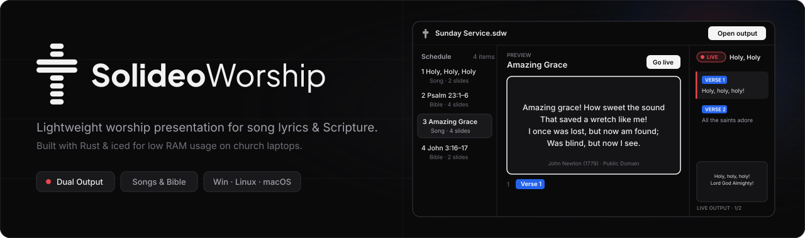
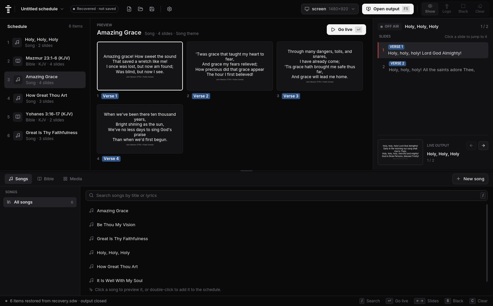
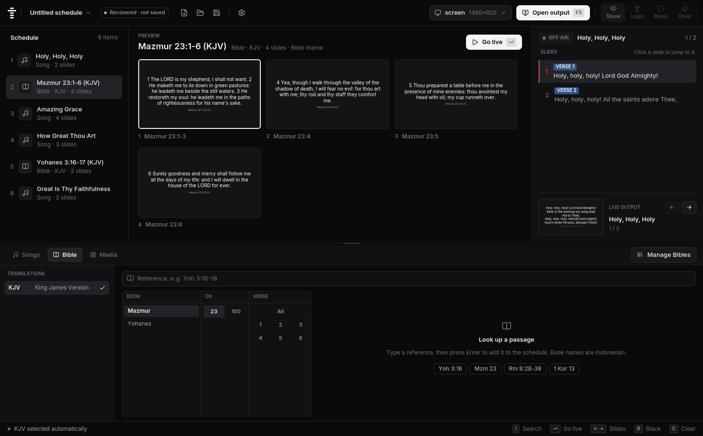
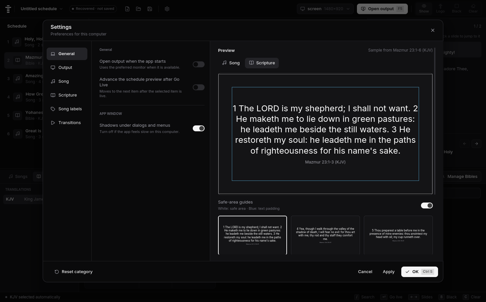

<p align="center">
  
</p>

<p align="center">
  <a href="https://github.com/MikeNoppo/solideoworship-app/actions/workflows/ci.yml"></a>
  <a href="https://github.com/MikeNoppo/solideoworship-app/releases"></a>
  <a href="LICENSE"></a>
</p>

A lightweight, open-source worship presentation app for song lyrics and Bible verses, written in Rust with [iced](https://iced.rs).

SolideoWorship keeps a familiar EasyWorship-style workflow while keeping **runtime performance and low memory usage** as the top priority for church media laptops.

> **Status: beta.** Songs and Bible presentation work, though the app has not yet been tested extensively in live services. Report bugs in [Issues](https://github.com/MikeNoppo/solideoworship-app/issues).

## Screenshots

<p align="center">
  
</p>

| Bible Browser & Preview | Settings & Safe-Area Preview |
| --- | --- |
|  |  |

## Features

- **Dual-window output:** Operator control window on your laptop and fullscreen projector output from one shared state.
- **Song library & editor:** Fast full-text search, section-based lyrics (`[Verse 1]`, `[Chorus]`), custom labels/shortcuts, and live slide preview.
- **Bible lookup:** Import UTF-8 Zefania XML translations and search passages (`Yoh 3:16-18`, `Mzm 23`) without splitting verses mid-slide.
- **Portable schedules:** Save `.sdw` schedule files with embedded songs and verses, plus automatic crash recovery.
- **Customizable presentation:** Fonts, colors, margins, slide limits, Show/Black/Clear modes, and Cut/Fade transitions.
- **Multilingual UI:** English and Indonesian interfaces.

## Install

Download installers from [Releases](https://github.com/MikeNoppo/solideoworship-app/releases) (builds are not code-signed yet).

- **Windows 10+ (x64):** Run `SolideoWorship-<version>-windows-x64-setup.exe` (click **More info → Run anyway** if SmartScreen prompts).
- **Linux (x86_64, glibc 2.35+):** Requires Wayland/X11, Vulkan/OpenGL, and `xdg-desktop-portal` or `zenity` for file dialogs.
  ```sh
  tar xzf SolideoWorship-<version>-linux-x86_64.tar.gz
  cd SolideoWorship-<version>-linux-x86_64
  ./install.sh               # installs per user into ~/.local
  ./install.sh --uninstall   # removes the app, keeps your library
  ```
- **macOS:** No installer yet; [build from source](#building-from-source).

## Quick notes

- **Lyrics format:** Put section headings in `[brackets]` on their own line; blank lines start a new slide.
- **Bibles:** Texts are not bundled due to copyright. Import your own UTF-8 Zefania XML file from **Bible → Manage Bibles**.
- **Language & data:** Override startup language with `SDW_LANG` (`en` or `id`) and data folder with `SDW_DATA_DIR`. Default data locations: `%LOCALAPPDATA%\SolideoWorship` (Windows), `~/Library/Application Support/SolideoWorship` (macOS), `~/.local/share/solideoworship` (Linux).

## Building from source

Requires [Rust](https://rustup.rs) and a C compiler for bundled SQLite (Visual Studio Build Tools on Windows, Xcode Command Line Tools on macOS, `libxcb1-dev` on Linux):

```sh
git clone https://github.com/MikeNoppo/solideoworship-app.git
cd solideoworship-app
cargo run -p sdw-app
```

## Contributing

Bug reports, translations, and pull requests are welcome. See [CONTRIBUTING.md](CONTRIBUTING.md) before opening a PR and [AGENTS.md](AGENTS.md) for architecture notes.

## License

Copyright © 2026 MikeNoppo. Released under the [GNU General Public License v3.0](LICENSE) (`GPL-3.0-only`).
