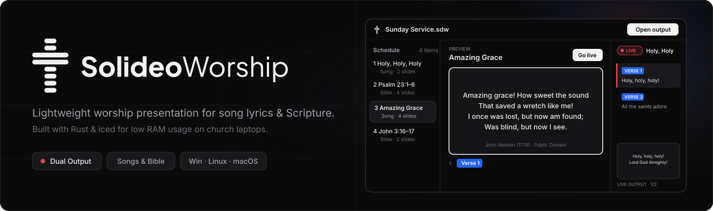
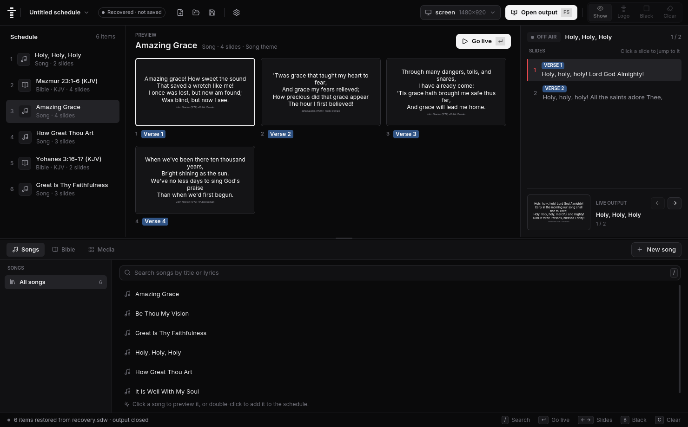
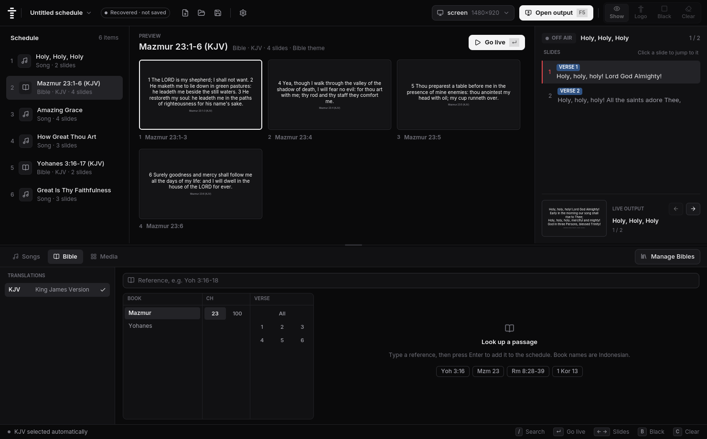
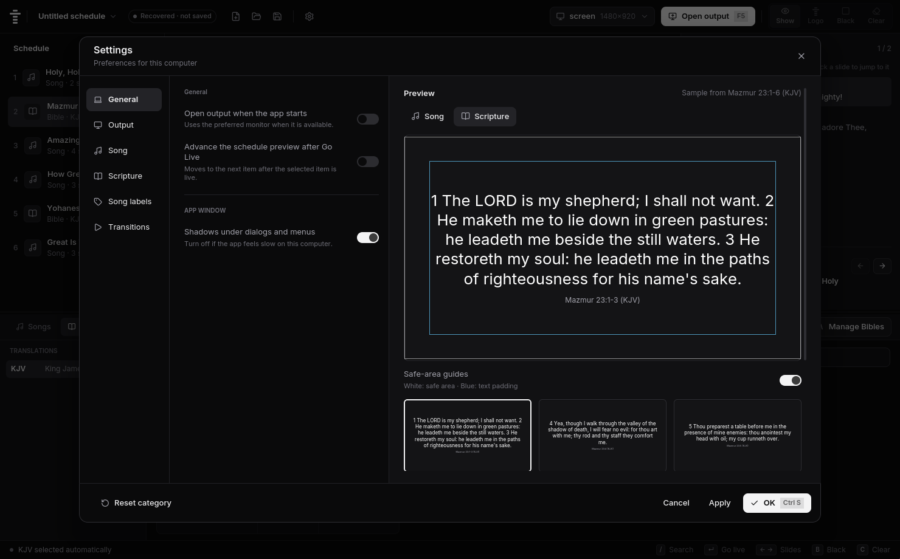

<p align="center">
  
</p>

<p align="center">
  <a href="https://github.com/MikeNoppo/solideoworship-app/actions/workflows/ci.yml"></a>
  <a href="https://github.com/MikeNoppo/solideoworship-app/releases"></a>
  <a href="LICENSE"></a>
</p>

A lightweight, open-source worship presentation app for song lyrics and Bible verses, written in Rust with [iced](https://iced.rs).

SolideoWorship keeps a familiar EasyWorship-style workflow while keeping **runtime performance and low memory usage** as the top priority for church media laptops.

> **Status: beta.** Songs and Bible presentation work, though the app has not yet been tested extensively in live services. Report bugs in [Issues](https://github.com/MikeNoppo/solideoworship-app/issues).

## Screenshots

<p align="center">
  
</p>

| Bible Browser & Preview | Settings & Safe-Area Preview |
| --- | --- |
|  |  |

## Features

- **Dual-window output:** Operator control window on your laptop and fullscreen projector output from one shared state.
- **Song library & editor:** Fast full-text search, section-based lyrics (`[Verse 1]`, `[Chorus]`), custom labels/shortcuts, and live slide preview.
- **Bible lookup:** Import UTF-8 Zefania XML translations and search passages (`Yoh 3:16-18`, `Mzm 23`) without splitting verses mid-slide.
- **Portable schedules:** Save `.sdw` schedule files with embedded songs and verses, plus automatic crash recovery.
- **Customizable presentation:** Fonts, colors, margins, slide limits, Show/Black/Clear modes, and Cut/Fade transitions.
- **Multilingual UI:** English and Indonesian interfaces.

## Install

Download packages from [Releases](https://github.com/MikeNoppo/solideoworship-app/releases). Windows packages are not Authenticode-signed; macOS beta builds use ad hoc signatures and are not notarized.

| Platform | Package | Installation |
| --- | --- | --- |
| Windows 10+ x64 | `windows-x64-nsis.exe` | Run the installer; choose the current user or all users |
| Windows 10+ x64 | `windows-x64.msi` | Run the installer; installs for all users |
| macOS 15+ Intel / Apple Silicon | `macos-<arch>.dmg` | Drag `SolideoWorship.app` into a writable Applications folder |
| macOS 15+ Intel / Apple Silicon | `macos-<arch>.app.tar.gz` | Extract the `.app` bundle into a writable Applications folder |
| Linux x86_64, glibc 2.35+ | `linux-x86_64.AppImage` | Make executable and run; FFmpeg libraries are bundled |
| Ubuntu 22.04 or compatible x86_64 | `linux-x86_64.deb` | `sudo apt install ./SolideoWorship-<version>-linux-x86_64.deb` |
| Arch / Omarchy x86_64 | `linux-x86_64.pkg.tar.zst` | `sudo pacman -U ./SolideoWorship-<version>-linux-x86_64.pkg.tar.zst` |

All names start with `SolideoWorship-<version>-`. macOS architectures are `x86_64` (Intel) and `aarch64` (Apple Silicon). Beta builds may need approval in **System Settings → Privacy & Security** on macOS or **More info → Run anyway** on Windows. Stable macOS distribution is deferred until Developer ID signing and notarization are configured.

Linux needs a working Wayland/X11 session, Vulkan/OpenGL drivers, audio, and `xdg-desktop-portal` or `zenity` for file dialogs. AppImage may need FUSE 2; use `APPIMAGE_EXTRACT_AND_RUN=1 ./SolideoWorship-<version>-linux-x86_64.AppImage` if FUSE is unavailable.

### Updating SolideoWorship

Official NSIS, MSI, AppImage and writable macOS bundle installations check GitHub Releases at startup. Use **Check for updates** to check again. Updates preserve the installed package format and CPU architecture. A beta can upgrade to a later beta or stable release; stable installations receive stable updates.

Select **Download update**, close the projector output, then select **Install and restart**. The app verifies the Ed25519 release signature and package checksum, prompts you to save an edited schedule, and reopens the saved schedule after updating. System-wide Windows installations can request administrator approval. A failed preflight leaves the installed version in place; AppImage and macOS bundle replacement also restores the previous files if the installed version fails its probe.

For `.deb` and Arch packages, install the newer package with `apt` or `pacman`. No APT/Pacman repository or AUR publishing is configured yet. If an AppImage or macOS bundle is in a folder you cannot write, install the new package manually into a writable location.

### Moving from beta.3 or earlier

The old Inno and Linux tarball releases do not contain the updater. Install beta.4 once manually. Uninstall the old application before changing installer formats; the application data folders and saved `.sdw` files stay in place.

On Windows, preserve an explicit language choice before uninstalling: copy `language` from the old application folder into `%LOCALAPPDATA%\SolideoWorship\language`. NSIS offers English and Indonesian; MSI uses the existing data-folder preference or the operating system locale. To remove an old Linux per-user installation, run `./install.sh --uninstall` from its original release archive before installing the new package.

## Quick notes

- **Lyrics format:** Put section headings in `[brackets]` on their own line; blank lines start a new slide.
- **Bibles:** Texts are not bundled due to copyright. Import your own UTF-8 Zefania XML file from **Bible → Manage Bibles**.
- **Language & data:** Override startup language with `SDW_LANG` (`en` or `id`) and data folder with `SDW_DATA_DIR`. Default data locations: `%LOCALAPPDATA%\SolideoWorship` (Windows), `~/Library/Application Support/SolideoWorship` (macOS), `~/.local/share/solideoworship` (Linux).

## Building from source

Requires [Rust](https://rustup.rs) and a C compiler for bundled SQLite (Visual Studio Build Tools on Windows, Xcode Command Line Tools on macOS, `libxcb1-dev` on Linux):

```sh
git clone https://github.com/MikeNoppo/solideoworship-app.git
cd solideoworship-app
cargo run -p sdw-app
```

## Contributing

Bug reports, translations, and pull requests are welcome. See [CONTRIBUTING.md](CONTRIBUTING.md) before opening a PR and [AGENTS.md](AGENTS.md) for architecture notes.

## Signing update releases

Generate an Ed25519 key on a trusted machine. Keep the private key outside Git.

```sh
umask 077
openssl genpkey -algorithm ED25519 -out release-signing.pem
public_der=$(openssl pkey -in release-signing.pem -pubout -outform DER | od -An -v -tx1 | tr -d ' \n')
printf '%s\n' "${public_der#302a300506032b6570032100}"
```

Set the `SDW_UPDATE_PUBLIC_KEY` repository variable to the printed 64-character hex public key. Create a GitHub Actions environment named `release-signing`, restrict it to release tags (`v*`), and set its `SDW_UPDATE_SIGNING_KEY` secret to the full PEM content. Use the same key for subsequent releases so existing installations can verify them. If the key is lost or compromised, distribute a new installer manually with a replacement public key.

Existing `SDW_UPDATE_PUBLIC_KEY` and `SDW_UPDATE_SIGNING_KEY` values continue to work after the packager migration. Cargo Packager's own signing keys are not used.

The tag workflow verifies the key pair, signs `SHA256SUMS.txt` covering every final package, and attaches `SHA256SUMS.txt.sig` to the draft. Check that all packages and both checksum files are attached before publishing. Only published releases are offered by the updater. `workflow_dispatch` builds and tests packages without accessing the signing environment or publishing a release.

## Building packages

Install Python 3.11+ and `cargo install cargo-packager --version 0.11.8 --locked`, then run `python3 packaging/package.py` on the target OS. Windows also needs the FFmpeg SDK described in `.github/actions/setup-windows-ffmpeg/action.yml`; set `FFMPEG_BIN_DIR`, `FFMPEG_INCLUDE_DIR`, and `FFMPEG_LIB_DIR`. Linux builds need the FFmpeg development libraries, ALSA, XCB and `pkg-config`. Debian packaging additionally uses `dpkg-dev`. On Arch, run `python3 packaging/package.py --format pacman` as a regular user with `base-devel` and runtime dependencies installed. macOS builds need Homebrew FFmpeg and `pkg-config`.

Artifacts are written under `target/dist/<platform>-<arch>/` (respecting `CARGO_TARGET_DIR`). The release workflow builds Debian and AppImage on Ubuntu 22.04 and builds Pacman packages separately on Arch to match FFmpeg's ABI. macOS dylibs are bundled, relinked and signed before creating the DMG and `.app.tar.gz`; archives preserve the executable modes and contain regular files only.

MSI versions use `major.minor.(patch * 1000 + rank)`, where beta ranks are 1–499, release candidate ranks are 501–998, and stable is 999. This preserves upgrade ordering in Windows Installer's first three fields. Unsupported version shapes or overflows fail packaging instead of reusing an upgrade version.

The release workflow tests clean installs, signed upgrades between two fixture versions, and rejection of a package whose executable fails preflight. Windows system installation tests run only on disposable Actions runners; Unix smoke tests use temporary installation directories. Run `python3 -m unittest discover -s packaging -p 'test_*.py'` for the portable packaging tests.

## License

Copyright © 2026 MikeNoppo. Released under the [GNU General Public License v3.0](LICENSE) (`GPL-3.0-only`).
